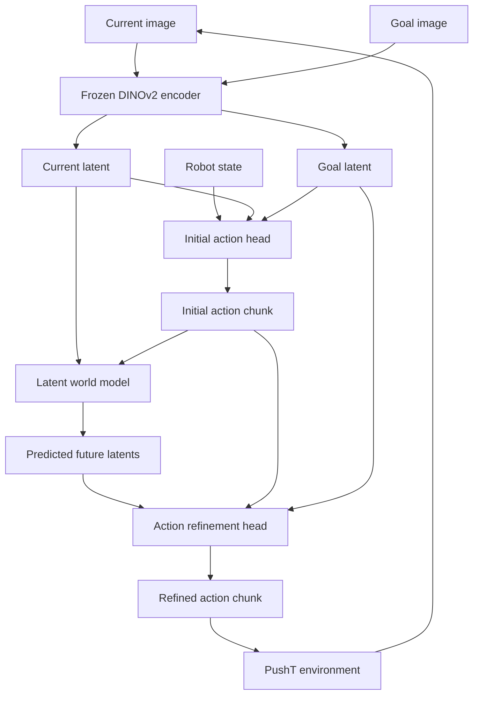

# LWAM — Lightweight Latent World Action Model

A lightweight robotics research project exploring action-conditioned latent world modeling and future-aware action generation on consumer-grade GPUs.

> **Project status:** v0.1 research prototype. CPU unit tests and synthetic training smoke tests passed; real PushT, DINOv2 download and GPU performance remain unverified.

## Quick start

See [Korean execution guide](QUICKSTART_ko.md) for the actual commands, dependencies and validation limits. The code uses a state-conditioned dynamics model that predicts both the next latent and robot state. The following research plan describes the broader intended architecture.

## Overview

LWAM investigates whether a robot can improve its actions by predicting the future consequences of its own proposed actions in a compact latent space. Rather than training a large vision-language-action (VLA) model from scratch, LWAM reuses a frozen, pretrained DINOv2 vision encoder and trains a small dynamics model, action head, and action refinement head.

The initial task is simulated PushT manipulation. The first version is goal-image-conditioned, not language-conditioned. Language conditioning and real-robot deployment are future extensions.

## Research objectives

- Learn an action-conditioned latent dynamics model using robot demonstration trajectories.
- Predict multiple future latent states without generating pixel-level video.
- Generate an initial action chunk and refine it using predicted future states.
- Evaluate whether future-aware refinement improves task success over behavior cloning.
- Explore data efficiency and training feasibility on an NVIDIA RTX 4070 Laptop GPU with 8 GB VRAM.

## Proposed architecture



| Component | Initial design | Training |
| --- | --- | --- |
| Vision / goal encoder | Shared DINOv2 ViT-S/14 | Frozen |
| Latent world model | Residual MLP, action-conditioned | Trainable |
| Initial action head | Goal-conditioned MLP | Trainable |
| Action refiner | Residual action prediction MLP | Trainable |

### Mathematical formulation

Let `I_t` denote the current image, `s_t` the robot state, `I_g` the goal image, and `a_t` the action executed between two observations.

**Latent encoding**

$$z_t = E(I_t),\qquad z_g = E(I_g)$$

**Initial action chunk**

$$\tilde{A}_t = \pi_\phi(z_t,s_t,z_g)$$

**Action-conditioned latent rollout**

$$\hat{z}_{t+k+1} = f_\theta(\hat{z}_{t+k},\tilde{a}_{t+k}),\qquad \hat{z}_t=z_t$$

**Future-aware action refinement**

$$A_t^{\mathrm{ref}} = \tilde{A}_t + g_\psi(\tilde{A}_t,\hat{Z}_t,z_g)$$

For supervised dynamics training, rollouts use recorded actions, not arbitrary predicted actions, so the predicted states can be compared with the corresponding recorded future observations. For policy training, the model predicts futures conditioned on its own proposed action chunk.

A candidate joint objective is:

$$\mathcal{L} = \lambda_w\mathcal{L}_{\mathrm{world}} + \lambda_i\mathcal{L}_{\mathrm{initial}} + \lambda_r\mathcal{L}_{\mathrm{refined}}$$

The world loss measures latent prediction error on recorded transitions; the initial and refined action losses measure imitation error against expert actions. Goal and smoothness losses may be explored later.

## Repository structure

```text
lwam/
├── README.md
├── requirements.txt
├── configs/
│   └── rtx4070_8gb.yaml
├── src/
│   └── lwam/
│       ├── models/
│       │   ├── vision_encoder.py
│       │   ├── tiny_dynamics.py
│       │   ├── action_head.py
│       │   ├── action_refiner.py
│       │   └── lwam.py
│       ├── data/
│       │   ├── dataset.py
│       │   └── latent_cache.py
│       └── training/
│           ├── train_world_model.py
│           ├── train_action_model.py
│           ├── train_joint.py
│           └── losses.py
├── scripts/
│   ├── download_dataset.py
│   └── build_latent_cache.py
├── tests/
├── data/
├── checkpoints/
└── outputs/
```

This is the planned source layout. Package initialization files, packaging metadata, and `.gitignore` should be added as implementation progresses. Large datasets, caches, checkpoints, and generated outputs should not be committed to Git.

## Development environment

| Item | Target |
| --- | --- |
| OS | Ubuntu 22.04 / 24.04 |
| Language | Python 3.10 / 3.11 (subject to dependency compatibility) |
| Framework | PyTorch |
| GPU | NVIDIA GeForce RTX 4070 Laptop GPU (8 GB VRAM) |
| CPU | Intel Core Ultra 9 185H |
| RAM | 64 GB class |
| Storage | 2 TB SSD |
| Dataset / simulation | LeRobot / PushT |
| Visualization | Matplotlib / TensorBoard |

### Initial setup

After cloning the repository:

```bash
cd lwam
python3 -m venv .venv
source .venv/bin/activate
python -m pip install --upgrade pip
```

Install a CUDA-compatible PyTorch build using the [official PyTorch installation instructions](https://pytorch.org/get-started/locally/). Once `requirements.txt` is implemented and dependency versions are validated, install the remaining dependencies:

```bash
python -m pip install -r requirements.txt
export PYTHONPATH="$PWD/src${PYTHONPATH:+:$PYTHONPATH}"
python -c "import torch; print(torch.cuda.is_available())"
```

These are intended setup steps; training entry points and dependency pins are not yet implemented or tested.

## Data pipeline

Each training sample will include time-aligned observations, robot states, recorded actions, and a goal representation. Episode boundaries and terminal transitions must be respected. Training, validation, and test splits will be made by episode before building the latent cache to avoid leakage. Goal images will be selected using a documented goal definition available at inference time.

Frozen DINOv2 features will be precomputed and cached on disk to reduce GPU memory usage during training. The initial baseline uses 384-dimensional CLS features; spatial patch features will be investigated if the representation loses task-relevant position information.

## Training pipeline

1. Prepare PushT trajectories and split episodes.
2. Extract and cache frozen DINOv2 features using deterministic preprocessing.
3. Train the world model on recorded state-action-next-state transitions, then extend to multi-step rollout loss.
4. Train the initial action head using behavior cloning.
5. Freeze the trained world model and train the action refiner using predicted future latents.
6. Optionally fine-tune dynamics and action modules jointly while retaining supervised dynamics loss on recorded transitions.
7. Evaluate in closed-loop simulation using held-out episodes and randomized seeds.

## Initial configuration targets

| Hyperparameter | Proposed value |
| --- | --- |
| Input image size | 224 × 224 |
| Encoder feature dimension | 384 |
| Dynamics hidden dimension | 512 |
| Action dimension (PushT) | 2 |
| Action chunk / rollout horizon | 5 steps |
| Batch size (cached latents) | 32 |
| Optimizer | AdamW |
| Learning rate | 3e-4 |
| Precision | FP32 baseline; BF16 mixed precision if supported |
| Training steps | 10,000 (initial experiment target) |
| Latent cache | Enabled |
| LoRA / quantization | Disabled for v0.1 |

These values are starting points, not measured optimal settings. The trainable modules are intended to remain in the low-million-parameter range. Actual parameter counts, peak VRAM, runtime, and performance will be measured after implementation.

## Evaluation plan

| Experiment | Description |
| --- | --- |
| Behavior cloning | Same encoder and initial action head, without world modeling |
| World-model-assisted planning | Learned dynamics with candidate action selection (future baseline) |
| LWAM | Initial action head, latent rollout, and action refinement |

Report task success rate, final goal error, action error, one-step and multi-step latent prediction error, inference latency, peak GPU memory, trainable parameter count, and performance across different training dataset sizes. Compare against a persistence baseline for latent prediction and a parameter-matched action-only policy where practical. Use identical data splits and evaluation seeds for fair comparison.

## Roadmap

- [ ] v0.1 — Frozen DINOv2 + MLP dynamics + action head and refiner in PushT
- [ ] v0.2 — Spatial patch features and Transformer-based dynamics
- [ ] v0.3 — Latent-space planning using CEM or MPPI
- [ ] v0.4 — Language-conditioned action generation
- [ ] v0.5 — Real-robot integration with SO-101 / LeRobot
- [ ] v0.6 — Mobile manipulation and deployment optimization (ONNX / TensorRT where compatible)

## References and acknowledgements

- [DINOv2: Learning Robust Visual Features without Supervision](https://arxiv.org/abs/2304.07193) — pretrained visual representations.
- [DINO-WM: World Models on Pre-trained Visual Features Enable Zero-shot Planning](https://proceedings.mlr.press/v267/zhou25t.html) — action-conditioned latent world modeling and planning.
- [LeRobot](https://github.com/huggingface/lerobot) — robot learning tools and datasets.
- [Diffusion Policy](https://diffusion-policy.cs.columbia.edu/) — robot manipulation and PushT benchmark context.

LWAM is an independent experimental project inspired by these works. It is not an official implementation or an affiliated project.

## License

The license for original LWAM source code has not yet been selected. Third-party code, pretrained weights, and datasets remain subject to their respective licenses and usage terms. No rights to redistribute third-party assets are implied by this README.
