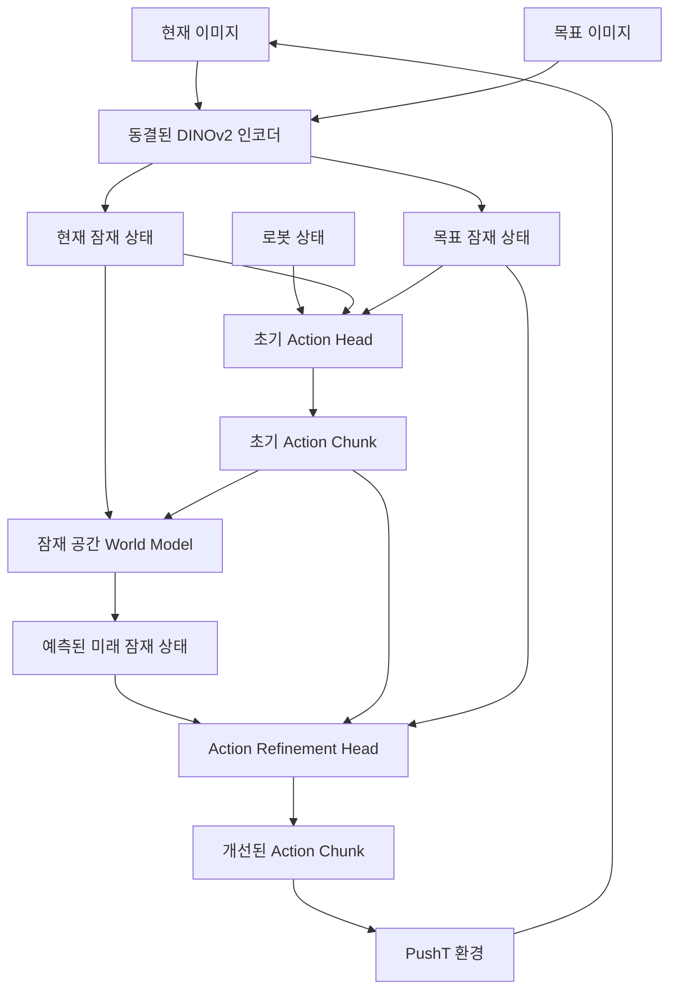

# LWAM — 경량 잠재 공간 월드 액션 모델 (Lightweight Latent World Action Model)

일반 소비자용 GPU 환경에서 행동 조건부 잠재 공간 월드 모델링(Action-Conditioned Latent World Modeling)과 미래 예측 기반 행동 생성을 연구하는 경량 로봇 AI 프로젝트입니다.

> **프로젝트 상태:** 초기 연구 및 개발 단계(v0.1 계획 중). 아래의 아키텍처, 학습 파이프라인 및 하드웨어 목표는 검증된 결과가 아닌 제안 사항입니다.

## 개요

LWAM은 로봇이 스스로 제안한 행동의 미래 결과를 압축된 잠재 공간(Latent Space)에서 예측함으로써 자신의 행동을 개선할 수 있는지 연구합니다. 대규모 Vision-Language-Action(VLA) 모델을 처음부터 학습하는 대신, 사전학습된 DINOv2 비전 인코더를 동결하여 재사용하고 소형 Dynamics Model, Action Head 및 Action Refinement Head를 학습합니다.

초기 태스크는 PushT 시뮬레이션 기반 로봇 조작입니다. 첫 번째 버전은 언어 명령이 아닌 목표 이미지(Goal Image)를 조건으로 사용합니다. 언어 조건부 행동 생성과 실물 로봇 적용은 향후 확장할 예정입니다.

## 연구 목표

- 로봇 시연 궤적 데이터를 활용하여 행동 조건부 잠재 공간 Dynamics Model을 학습합니다.
- 픽셀 단위의 영상을 생성하지 않고 여러 미래 시점의 잠재 상태를 예측합니다.
- 초기 Action Chunk를 생성하고 예측된 미래 상태를 활용하여 행동을 개선합니다.
- 미래 예측 기반 행동 개선이 행동 복제(Behavior Cloning) 대비 태스크 성공률을 향상시키는지 평가합니다.
- NVIDIA RTX 4070 Laptop GPU(8 GB VRAM)에서 데이터 효율성과 학습 가능성을 검토합니다.

## 제안 아키텍처



| 구성 요소 | 초기 설계 | 학습 여부 |
| --- | --- | --- |
| 비전 / 목표 인코더 | DINOv2 ViT-S/14 공유 | 동결 |
| 잠재 공간 World Model | 행동 조건부 Residual MLP | 학습 |
| 초기 Action Head | 목표 조건부 MLP | 학습 |
| Action Refiner | 잔차 기반 행동 예측 MLP | 학습 |

### 수학적 정의

`I_t`는 현재 이미지, `s_t`는 로봇 상태, `I_g`는 목표 이미지, `a_t`는 두 관측 시점 사이에 실행된 행동을 나타냅니다.

**잠재 표현 인코딩(Latent Encoding)**

$$z_t = E(I_t),\qquad z_g = E(I_g)$$

**초기 Action Chunk 생성**

$$\tilde{A}_t = \pi_\phi(z_t,s_t,z_g)$$

**행동 조건부 잠재 상태 순차 예측(Latent Rollout)**

$$\hat{z}_{t+k+1} = f_\theta(\hat{z}_{t+k},\tilde{a}_{t+k}),\qquad \hat{z}_t=z_t$$

**미래 예측 기반 행동 개선(Future-aware Action Refinement)**

$$A_t^{\mathrm{ref}} = \tilde{A}_t + g_\psi(\tilde{A}_t,\hat{Z}_t,z_g)$$

지도학습 기반 Dynamics 학습에서는 임의로 예측한 행동이 아니라 데이터에 기록된 실제 행동을 사용하여 Rollout을 수행합니다. 이를 통해 예측 상태와 그 행동에 대응하는 실제 미래 관측값을 비교할 수 있습니다. 정책 학습(Policy Training)에서는 모델이 스스로 제안한 Action Chunk를 조건으로 미래 상태를 예측합니다.

공동 학습(Joint Training)의 후보 목적함수는 다음과 같습니다.

$$\mathcal{L} = \lambda_w\mathcal{L}_{\mathrm{world}} + \lambda_i\mathcal{L}_{\mathrm{initial}} + \lambda_r\mathcal{L}_{\mathrm{refined}}$$

World Loss는 기록된 상태 전이에서 잠재 상태 예측 오차를 측정하며, 초기 행동 및 개선된 행동의 Loss는 전문가 행동에 대한 모방 오차를 측정합니다. 목표 오차(Goal Loss)와 행동 평활화 오차(Smoothness Loss)는 향후 검토할 수 있습니다.

## 저장소 구조

```text
lwam/
├── README.md
├── requirements.txt
├── configs/
│   └── rtx4070_8gb.yaml
├── src/
│   └── lwam/
│       ├── models/
│       │   ├── vision_encoder.py
│       │   ├── tiny_dynamics.py
│       │   ├── action_head.py
│       │   ├── action_refiner.py
│       │   └── lwam.py
│       ├── data/
│       │   ├── dataset.py
│       │   └── latent_cache.py
│       └── training/
│           ├── train_world_model.py
│           ├── train_action_model.py
│           ├── train_joint.py
│           └── losses.py
├── scripts/
│   ├── download_dataset.py
│   └── build_latent_cache.py
├── tests/
├── data/
├── checkpoints/
└── outputs/
```

위 구조는 계획된 소스 코드 구성입니다. 구현이 진행됨에 따라 패키지 초기화 파일, 패키징 메타데이터 및 `.gitignore`를 추가해야 합니다. 대용량 데이터셋, 캐시, 체크포인트 및 생성된 결과물은 Git에 커밋하지 않는 것을 권장합니다.

## 개발 환경

| 항목 | 목표 사양 |
| --- | --- |
| 운영체제 | Ubuntu 22.04 / 24.04 |
| 프로그래밍 언어 | Python 3.10 / 3.11 (의존성 호환 여부에 따라 결정) |
| 딥러닝 프레임워크 | PyTorch |
| GPU | NVIDIA GeForce RTX 4070 Laptop GPU (8 GB VRAM) |
| CPU | Intel Core Ultra 9 185H |
| RAM | 64 GB급 |
| 저장장치 | 2 TB SSD |
| 데이터셋 / 시뮬레이션 | LeRobot / PushT |
| 시각화 | Matplotlib / TensorBoard |

### 초기 환경 설정

저장소를 복제(Clone)한 후 다음 명령어를 실행합니다.

```bash
cd lwam
python3 -m venv .venv
source .venv/bin/activate
python -m pip install --upgrade pip
```

[PyTorch 공식 설치 가이드](https://pytorch.org/get-started/locally/)를 참고하여 CUDA와 호환되는 PyTorch 버전을 설치합니다. `requirements.txt` 작성과 의존성 버전 검증이 완료되면 나머지 라이브러리를 설치합니다.

```bash
python -m pip install -r requirements.txt
export PYTHONPATH="$PWD/src${PYTHONPATH:+:$PYTHONPATH}"
python -c "import torch; print(torch.cuda.is_available())"
```

위 내용은 예정된 환경 설정 절차이며, 학습 실행 코드와 의존성 버전 고정은 아직 구현하거나 테스트하지 않았습니다.

## 데이터 파이프라인

각 학습 샘플에는 시간적으로 정렬된 관측값, 로봇 상태, 기록된 행동 및 목표 표현이 포함됩니다. 에피소드 경계와 종료 상태 전이를 올바르게 처리해야 합니다. 데이터 누출을 방지하기 위해 잠재 표현 캐시를 생성하기 전에 에피소드 단위로 학습(Train), 검증(Validation), 테스트(Test) 데이터를 분할합니다. 목표 이미지는 추론 시점에도 사용할 수 있도록 문서화된 목표 정의에 따라 선택합니다.

학습 과정에서 GPU 메모리 사용량을 줄이기 위해 동결된 DINOv2의 특징을 미리 계산하여 디스크에 저장합니다. 초기 베이스라인은 384차원 CLS 특징을 사용하며, 태스크에 필요한 위치 정보가 손실될 경우 공간 정보를 보존하는 Patch Features를 검토합니다.

## 학습 파이프라인

1. PushT 궤적 데이터를 준비하고 에피소드 단위로 분할합니다.
2. 결정론적 전처리를 사용하여 동결된 DINOv2 특징을 추출하고 캐시에 저장합니다.
3. 기록된 현재 상태-행동-다음 상태 전이를 이용해 World Model을 학습한 후 Multi-step Rollout Loss로 확장합니다.
4. 행동 복제(Behavior Cloning)를 통해 초기 Action Head를 학습합니다.
5. 학습된 World Model을 동결하고 예측된 미래 잠재 상태를 활용하여 Action Refiner를 학습합니다.
6. 선택적으로 기록된 상태 전이에 대한 지도학습 기반 Dynamics Loss를 유지하면서 Dynamics와 Action 모듈을 공동 파인튜닝합니다.
7. 학습에 사용하지 않은 에피소드와 무작위 시드(Seed)를 활용하여 폐루프(Closed-loop) 시뮬레이션에서 평가합니다.

## 초기 학습 설정 목표

| 하이퍼파라미터 | 제안 설정값 |
| --- | --- |
| 입력 이미지 크기 | 224 × 224 |
| 인코더 특징 차원 | 384 |
| Dynamics 은닉층 차원 | 512 |
| 행동 차원 (PushT) | 2 |
| Action Chunk / Rollout Horizon | 5 Steps |
| Batch Size (캐시된 잠재 표현 사용) | 32 |
| Optimizer | AdamW |
| Learning Rate | 3e-4 |
| 연산 정밀도 | FP32 베이스라인, 지원 시 BF16 혼합 정밀도 |
| 학습 Steps | 10,000 (초기 실험 목표) |
| Latent Cache | 활성화 |
| LoRA / 양자화 | v0.1에서는 비활성화 |

위 설정값은 실험의 시작점이며, 측정을 통해 확인한 최적값이 아닙니다. 학습 대상 모듈의 파라미터 수는 수백만 개 초반 수준으로 유지하는 것을 목표로 합니다. 실제 파라미터 수, 최대 VRAM 사용량, 실행 시간 및 성능은 구현 이후 측정할 예정입니다.

## 평가 계획

| 실험 모델 | 설명 |
| --- | --- |
| Behavior Cloning | 동일한 인코더와 초기 Action Head를 사용하되 World Model은 사용하지 않음 |
| World Model 기반 Planning | 학습된 Dynamics를 활용하여 행동 후보를 선택하는 방식 (향후 비교 모델) |
| LWAM | 초기 Action Head, 잠재 상태 Rollout 및 Action Refinement를 결합한 모델 |

태스크 성공률, 최종 목표 오차, 행동 예측 오차, 단일 및 다중 시점 잠재 상태 예측 오차, 추론 지연시간, 최대 GPU 메모리 사용량, 학습 대상 파라미터 수 및 학습 데이터셋 규모에 따른 성능을 보고합니다. 가능한 경우 잠재 상태 예측에는 현재 상태를 그대로 미래 예측값으로 사용하는 Persistence Baseline을 적용하고, 행동 생성에는 파라미터 규모를 맞춘 행동 전용 정책을 비교 대상으로 사용합니다. 공정한 비교를 위해 동일한 데이터 분할과 평가 시드를 사용합니다.

## 개발 로드맵

- [ ] v0.1 — PushT 환경에서 Frozen DINOv2 + MLP Dynamics + Action Head 및 Refiner 구현
- [ ] v0.2 — 공간 Patch Features 및 Transformer 기반 Dynamics
- [ ] v0.3 — CEM 또는 MPPI를 활용한 잠재 공간 Planning
- [ ] v0.4 — 언어 조건부 행동 생성
- [ ] v0.5 — SO-101 / LeRobot 기반 실물 로봇 연동
- [ ] v0.6 — 모바일 매니퓰레이션 및 배포 최적화 (호환되는 경우 ONNX / TensorRT 적용)

## 참고 문헌 및 감사의 글

- [DINOv2: Learning Robust Visual Features without Supervision](https://arxiv.org/abs/2304.07193) — 사전학습된 시각적 특징 표현.
- [DINO-WM: World Models on Pre-trained Visual Features Enable Zero-shot Planning](https://proceedings.mlr.press/v267/zhou25t.html) — 행동 조건부 잠재 공간 월드 모델링 및 행동 계획.
- [LeRobot](https://github.com/huggingface/lerobot) — 로봇 학습 도구 및 데이터셋.
- [Diffusion Policy](https://diffusion-policy.cs.columbia.edu/) — 로봇 조작 및 PushT 벤치마크 관련 연구.

LWAM은 위 연구들에서 영감을 받은 독립적인 실험 프로젝트입니다. 해당 연구의 공식 구현체이거나 관련 기관과 제휴된 프로젝트는 아닙니다.

## 라이선스

LWAM의 자체 소스 코드에 대한 라이선스는 아직 선정되지 않았습니다. 외부 소스 코드, 사전학습 가중치 및 데이터셋에는 각각의 라이선스와 이용 약관이 적용됩니다. 이 README는 외부 자산의 재배포 권한을 부여하지 않습니다.
